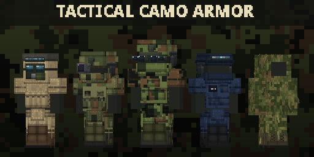

# Tactical Camo Armor



Bullet-resistant tactical armor for NeoForge 1.21.1 with working camouflage, helmet-mounted night vision and CS2-style grenades. Built for [TaCZ](https://modrinth.com/mod/tacz-1.21.1), but it works on its own and with other gun mods.

## Features

**Armor sets.** CS2 CT and T kits, US Woodland, Desert, OD Green, MultiCam and Snow, Russian Ratnik (EMR), ghillie suits (woodland and snow) and SWAT. Each set comes as a helmet, plate carrier, leggings and boots in light, medium and heavy tiers (ghillie suits are light only). The tiers look different, with plates, shoulder pads and extra pouches.

**Zone protection.** A hit is blocked by the piece that covers where it lands: helmet for the head, plate carrier for the torso, leggings for the legs, boots for the feet. Light blocks 25%, medium 40% and heavy 60%. Each heavy piece slows you down by 3%. Hit pieces lose durability.

**Camouflage.** A full camo set makes mobs notice you from 30% closer (50% while sneaking). It works better in biomes that match the pattern and worse in ones that clash with it. Ghillie suits are 1.5 times stronger.

**Helmet devices.** A PVS-14, GPNVG-18 (white or green phosphor) or a thermal imager mounts on the US, Ratnik, SWAT and CT helmets. Any helmet takes a gas mask. You attach and detach devices in a crafting grid. Night vision runs on batteries and the gas mask uses filters; both refill in a crafting grid. The thermal imager shows living things through smoke.

**Grenades.** Frag (no block damage), HE (breaks blocks), flashbang and smoke. Hold right-click to wind up and let go to throw. A tap lobs the grenade at your feet, and a full second of wind-up throws it furthest. Grenades bounce, tumble in flight and go off on a timer.
- The flashbang whites out players' screens and blinds mobs.
- Smoke hides everyone inside or behind the cloud from mobs.

## Controls

| Key | Action |
| --- | --- |
| `N` | Flip the night vision or thermal device up or down |
| Hold right mouse | Wind up a grenade throw; release to throw |

## Compatibility

- **Without a gun mod**, the zone protection applies to every damage type in the `#tacz_camo_armor:ballistic` tag. By default that is `#minecraft:is_projectile`: arrows, tridents and bullets from any gun mod that marks its damage as a projectile. To change what counts as a bullet, edit the tag in a datapack. The hit zone comes from the projectile's path; for hitscan weapons it comes from the shooter's line of sight.
- **Covered out of the box:**
  - through the projectile tag: Just Enough Guns, and NTGL-based mods such as Create: Gunsmithing;
  - through optional tag entries: Guns++ and Gamingbarn's Guns.
- **TaCZ** is detected automatically. Its bullets then use TaCZ's own headshot detection, and armor-piercing ammo gets through part of the protection.
- **JEI** shows info pages for every set, device and grenade.
- **Other gun mods** can integrate through `tacz_camo_armor.combat.BallisticHits`:
  - `claim(...)` marks the damage the integration handles itself;
  - `expect(target, source, slot, damage)` reports the exact hit right before the damage is dealt.

## Configuration

You can change both config files in game from the Mods screen.

- **`tacz_camo_armor-server.toml`**
  - protection per tier;
  - hit zone heights;
  - heavy slowdown;
  - camouflage strength;
  - battery and filter life;
  - grenade power, range and duration.
- **`tacz_camo_armor-client.toml`**
  - the field-of-view change while winding up a throw;
  - the strongest flashbang white-out, for players sensitive to bright flashes;
  - the night vision vignette.

## Requirements

- Minecraft 1.21.1, NeoForge 21.1.200+, Java 21
- GeckoLib 4.9+
- Optional: TaCZ 1.1.8+, JEI 19+

## Building

```
./gradlew runData build
```

The jar goes to `build/libs`. Models, textures, item models and the logo are generated by the scripts in `tools/` (Python 3 with NumPy and Pillow):
- `armor.py` makes the armor models and their textures;
- `textures.py` makes the material icons and overlays;
- `items.py` makes the 3D item models;
- `logo.py` makes the logo.
